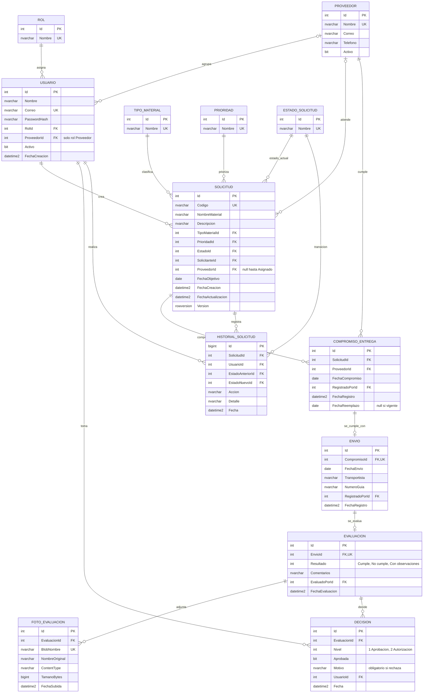
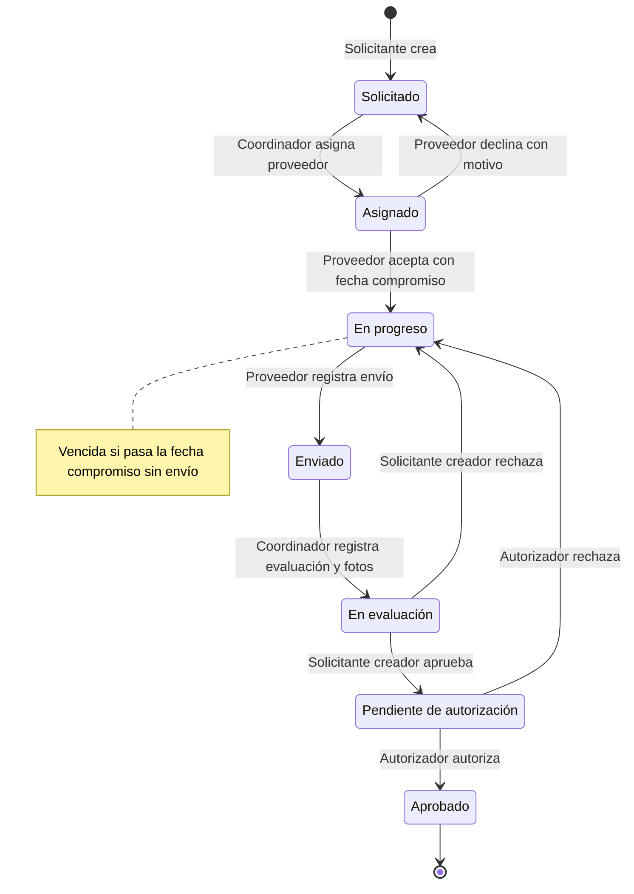

# Modelo de datos y flujo de solicitudes

## Diagrama entidad-relación

## Flujo de estados

## Roles

| Rol | Responsabilidad |
|---|---|
| Solicitante | Crea solicitudes y aprueba o rechaza la muestra de las solicitudes que creó. |
| Coordinador | Asigna la solicitud a un proveedor y registra la evaluación con fotos. |
| Proveedor | Acepta con fecha compromiso o declina, y registra el envío. Solo ve sus solicitudes. |
| Autorizador | Da la autorización final después de la aprobación del Solicitante. |

## Reglas de negocio

1. Solo se permiten las transiciones del diagrama y únicamente por el rol indicado.
2. El proveedor solo actúa sobre solicitudes asignadas a su empresa y el solicitante solo decide sobre las solicitudes que creó.
3. Rechazado no es un estado de reposo: la decisión de rechazo regresa la solicitud a En progreso y queda registrada en `DECISION` y en el historial.
4. El motivo es obligatorio al declinar una asignación y al rechazar una muestra.
5. Una solicitud aceptada por el proveedor ya no se puede reasignar.
6. La fecha objetivo y la fecha compromiso no pueden ser anteriores a hoy; la fecha de envío no puede ser posterior a hoy.
7. Ninguna fecha compromiso se sobrescribe: cada cambio crea un registro nuevo en `COMPROMISO_ENTREGA` y marca el anterior con `FechaReemplazo`.
8. Tras un rechazo, si la fecha compromiso aún no pasa se conserva y el proveedor puede cambiarla; si ya pasó, debe registrar una nueva antes de reenviar.
9. El proveedor solo puede cambiar la fecha compromiso después de un rechazo.
10. La evaluación requiere resultado, comentarios y de 1 a 5 fotos JPG, PNG o WEBP de hasta 5 MB cada una.
11. Cada cambio de la solicitud queda en `HISTORIAL_SOLICITUD` con usuario, acción, detalle y fecha.
12. Las fechas de auditoría se guardan en UTC; las fechas de negocio (objetivo, compromiso, envío y reemplazo) se guardan como fecha local sin hora.

## Indicadores

| Indicador | Cálculo |
|---|---|
| Solicitudes por estado | Conteo de solicitudes agrupado por estado actual. |
| Solicitudes vencidas | Solicitudes en En progreso cuyo compromiso vigente tiene fecha menor a hoy. |
| Entrega a tiempo | Envío con `FechaEnvio` menor o igual a la `FechaCompromiso` de su compromiso. |
| Compromiso vencido sin envío | Compromiso sin envío cuya fecha es menor a `FechaReemplazo`, o a hoy si sigue vigente. |
| % de entregas a tiempo por proveedor | Envíos a tiempo ÷ (envíos a tiempo + envíos tarde + compromisos vencidos sin envío). |
